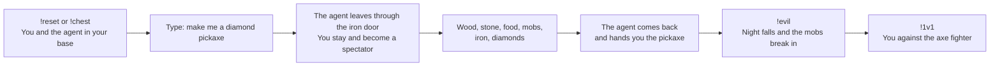

# Live demo walkthrough

This is the full show, in one world, on a real Minecraft server. You start in your own small base with the agent in front of you. You ask it for a diamond pickaxe in plain English. It walks off to do the job while you watch as a spectator. Then it comes back and hands you the pickaxe.



## Being built next

If you pick this up in another session, this is the target:

1. The evil god gets smarter plans. Code maps where mobs can really walk and tests each plan on that map. Claude Haiku chooses among the plans that passed and remembers what worked against this player.
2. It can tell a base from a plain building or a dug-in hole. It looks for a respawn bed, chests and furnaces that have been used, blocks the player placed, time spent there and defenses. It rules out villages, temples and other structures the game generated.
3. It can reach a player who dug into the ground. It finds the cheapest route through the ground, chains creeper blasts, and comes through nearby caves.
4. The night siege in step 7 passes its tests in a simulated world and still needs a full run on a real server.
5. The small display in the corner of the screen becomes part of this repo. It shows the agent's health, food, distance from you, time gone on the job, ready and raw food, building blocks, tools with durability, and other items.

## Start it

You need the agents server from [the setup guide](danger-sensing-agents-setup.md), running on this machine. Plain English needs an `ANTHROPIC_API_KEY` in your environment.

```sh
DEMO_PLAYER=<your Minecraft name> \
DEMO_FIGHTER_RUN=<folder of a trained fighter> \
node bridge/danger_sensing_agents/demo/run.js
```

Join the server. When the log says the demo is ready, type `!reset` in chat.

## The walkthrough

### 1. Start in your base

Type `!reset`. You stand in first person inside a small base. It has a bed, a chest, a furnace and cobblestone walls. The way in is an iron door in the south wall, with a lever on each side. The agent stands in front of you, facing you.

You can flip either lever yourself. The door stays open while either lever is on.

The agent starts with very little:

- A stone axe
- A shield
- 16 bread
- No armor

### 2. Ask for something in plain English

Type this in normal chat, with no command:

```text
make me a diamond pickaxe
```

Claude Haiku only reads your words and turns them into one request. A script plans every step from there. If your request is too vague, the agent asks what you mean. If it can't be done, the agent says so.

### 3. Watch it work

The agent answers and walks to the door. It flips its lever, walks through and flips the lever back to close the door behind it. It does the same on the way home. If it lands too far from the lever, it leaves the door open and keeps going. If you left the door open, it walks through and leaves it that way. It never breaks the door or the levers.

You stay exactly where you are and become a spectator. Your body keeps standing at your spot, so you can see yourself in the base. Your camera is your own, so you can look around or fly after it.

To see through the agent's eyes during a task, type `!pov` or `!follow`, or say something like `lemme see your pov`. To fly free again, type `!spec` or `!unfollow`, or say `back to spectator`.

If the agent dies during a task, you go straight into its new view. If you chose to fly free with `!spec`, you stay free until that task ends.

Haste is off unless you ask for it. `!haste` switches it, and `!haste on` or `!haste off` sets it. You can also say `use haste` or `mine faster`. Once on, it stays on through tasks, deaths and resets until you turn it off.

Watch for these along the way:

- **Tools:** it chops wood with the axe. The wooden pickaxe only digs 3 cobblestone, then it makes a stone pickaxe. Dirt is dug by hand or with a shovel, so the pickaxe doesn't wear out.
- **Food:** it kills close animals on the way, before it gets hungry. It eats ready food like bread first and cooks raw meat in a furnace with coal or wood.
- **Torches:** it makes a small stock from spare coal and places only a few.
- **Fights:** zombies, skeletons, endermen and creepers switch it to the trained mob network.
- **Lava:** it won't break a block that is holding lava back, its paths stay clear of lava, and it swims to the nearest bank if it falls in.
- **Mobs that can't reach it:** it ignores a mob with no walking route to it, like one sealed in a cave under its floor, and keeps digging. The mob counts again once a route opens. Endermen, flying mobs, skeletons with a clear shot and anything that hits it always count.
- **Tunnels:** it remembers the tunnels it dug and walks back through them on the next ore trip.
- **Ores:** it only knows about ore it can actually see, with no seeing through walls.
- **Dropped ore:** it keeps track of every ore it breaks and goes back for the drop, even after a fight.
- **Easy iron:** when it mines iron for a plan and sees more right in front of it, it takes that too, up to 12 for the job. It walks a step or two at most for it, and never digs or searches for the extra.
- **Diamonds, gold and lapis:** if it spots these on a job that doesn't need them, it leaves them in the ground and marks the spot. It tells you the coordinates once, asks if you want them, and keeps working. Say `get the gold` and it goes for them after the job it is on.

### 4. Show a feature on cue

During a task, a zombie arrives at about 60 seconds and an animal at about 120 seconds. You can also send them yourself:

```text
!mob skeleton
!animal cow
```

### 5. Get your pickaxe

The agent walks back to the base and through the door. Once it arrives, you return to your body's spot in creative mode, even if you flew far away. The standing body disappears. The agent faces you and hands over the pickaxe. The demo checks your inventory and tells you if the item reached you.

### 6. Try the short version

Type `!chest`. This is the same start, but the base chest already holds 3 diamonds, 2 sticks and 4 oak planks. Ask for a diamond pickaxe again. The agent takes what it needs from the chest, crafts the pickaxe and hands it to you. It skips the long pathway.

Plain `!reset` always empties the chest, so the agent does the whole job.

### 7. Wake the evil god

```text
!evil
```

This uses the base you are already in. The world turns to midnight and the agent leaves, so it is you against the mobs. To bring the agent back, type `!agent` or say `spawn the agent`.

The evil god directs the mobs already near your base. It only summons one when a job has nobody to do it. Then it attacks once:

1. It picks the wall with the driest route that zombies can reach, because water makes it hard for them to get in.
2. A creeper blows a hole in that wall.
3. An enderman moves nearby blocks to build a path across what is left, like the blast crater or a moat.
4. Zombies with wooden axes and iron helmets follow that path to you.

If no side can be reached, one creeper and 3 zombies make a simpler scripted attack. To attack again, type `!stop` or `!reset` first. A task, `!reset`, `!chest`, `!stop` or `!1v1` ends evil and brings the day back.

To see the enderman's path, type `!moat` first. It digs a water moat around the base, and `!reset` removes it.

Claude Haiku picks the plan from a fixed menu and writes a short taunt. It gets at most 4 calls per minute, 40 per hour and 150 until the demo restarts. If the model fails, times out or has no key, the scripted plan runs.

### 8. Fight it yourself

```text
!1v1
```

You and the trained axe fighter, who logs in as `FNN`, go to a yellow and black 20 by 20 arena in full diamond with an axe, sword, shield, crossbow and bow. Both of you are in adventure mode, so nothing can be broken or placed.

You start 16 blocks apart, with time to load a crossbow. The arena is open. Set `DEMO_PILLARS=1` to add 1 or 2 mirrored pairs of solid gray pillars to each fight. They are off by default because the fighter cannot see them yet.

A 3, 2, 1 countdown on a boss bar holds both of you still. Then the fight starts, with HP under each name. It lasts up to 3 minutes, then you return to your base.

To watch the fighter think, see [the live neuron screen](#the-live-neuron-screen).

### 9. Run it again

`!reset` rebuilds the base for another go. `!stop` stops whatever is happening and brings you back to the base.

## A match in its own world

This runs the same fight without the walkthrough. One command starts a separate Paper server with its own flat world, waits for you to join, plays a best of 3 (first to 2 wins) with a short score message between fights, and stops that server when it ends. A drawn fight does not count, and a match is at most 5 fights.

Before the first run:

1. Put a Paper 1.21.11 jar at `runs/one-v-one/paper.jar`, or set `ONE_V_ONE_PAPER` to its path. You need Java 21, and `ONE_V_ONE_JAVA` can point to it.
2. Read the [Minecraft EULA](https://aka.ms/MinecraftEULA). If you agree, create `runs/one-v-one/eula.txt` with the line `eula=true`. The command never accepts it for you. Without that line it stops and tells you what to do.

Then start it:

```sh
DEMO_PLAYER=<your Minecraft name> \
DEMO_FIGHTER_RUN=<folder of a trained fighter> \
node bridge/danger_sensing_agents/demo/one_v_one.js
```

Join `localhost:25570` when the log asks you to. The console uses port 25571. `ONE_V_ONE_PORT` and `ONE_V_ONE_CONSOLE_PORT` change them. The server only accepts connections from this machine, and everything it writes stays in `runs/one-v-one`, which git ignores. Press Ctrl-C to stop early. Only the server process this run started is stopped.

Set `ONE_V_ONE_STAY=1` to keep the server up. A new match then follows each one, and if you leave, it waits for you to come back.

## The live neuron screen

While a fight runs, in either version, open <http://127.0.0.1:8770>. The page keeps trying to reconnect between fights, so you can leave it open.

It has four columns: the input groups, 32 neurons from layer 1, 32 from layer 2, and the 11 action heads with the choice each one picked. A brighter blue node is more active. Lines are the strongest connections at this moment, blue when they excite and red when they inhibit, and thicker lines are stronger. Hover over anything to read its name, live value, what it is high and low on, what it reads and what it pushes.

Names only appear when they were measured on the exact network that is fighting. Otherwise the page says so and shows `Neuron <id>`, with the live connections but no made-up meaning.

The fight never waits for the page. Set `DEMO_NEURONS_PORT` to use another port, or to 0 for no screen.

## Commands

| Type this | What happens |
|---|---|
| Plain words | A task for the agent, like `make me a diamond pickaxe` |
| `!reset` or `!start` | Your base with an empty chest and the agent's starting kit |
| `!chest` | The same, with the chest stocked for a diamond pickaxe |
| `!pov` or `!follow` | During a task, shows you the agent's view |
| `!spec` or `!unfollow` | Lets go of the agent so you can fly free |
| `lemme see your pov`, `back to spectator` | The same camera moves in plain words |
| `!haste` | Switches Haste on or off for the agent |
| `!haste on`, `!haste off` | Sets Haste on or off |
| `use haste`, `mine faster` | Turns Haste on in plain words |
| `!mob [zombie, skeleton, enderman, creeper]` | Sends a mob at the agent |
| `!animal [cow, pig, sheep, chicken]` | Puts an animal next to the agent |
| `!evil` | Night falls and the mobs nearby attack your base, until a task, `!reset`, `!chest`, `!stop` or `!1v1` |
| `!agent` or `spawn the agent` | Brings the agent back during `!evil` |
| `!moat` | Digs a water moat around the base. `!reset` removes it |
| `!1v1` | One fight against the trained axe fighter, then you return to the base |
| `!stop` | Stops everything and brings you back to the base |
| `!help` | Lists the commands |

Only the player named in `DEMO_PLAYER` can run these.

## Mobs in the demo

The demo keeps the four hostile mobs the network trained against: zombie, skeleton, enderman and creeper. Every other hostile mob is removed. Animals stay, so the agent can hunt them.

## When the agent dies

Every death adds a line to `runs/demo/deaths.jsonl` with the cause, place, health, food, job, held item, nearby mobs and nearby lava. To count deaths by cause:

```sh
node bridge/danger_sensing_agents/tools/deaths_summary.js runs/demo
```

## Settings

Every setting is listed at the top of `bridge/danger_sensing_agents/demo/settings.js`.
