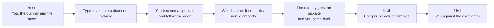

# Live demo walkthrough

This is the full show, in one world, on a real Minecraft server. You ask the agent for a diamond pickaxe in plain English and watch it do the whole job. Then you call in an evil mob attack on your base and fight the trained axe fighter yourself.



## Being built next

These change the walkthrough below. If you pick this up in another session, this is the target:

1. You start in your own first-person view inside a small base with a bed, chest, furnace and cobblestone walls. The agent stands in front of you. The dummy goes away.
2. You tell the agent what to do in plain English. It walks off. You stay where you are and switch to spectator, so you can look around or fly after it.
3. When it finishes, it comes back to the base, you return to a normal game mode, and it hands you the item while facing you.
4. A chest version, `!chest`, starts with the base chest already stocked, so the agent uses it and skips the long pathway. Test this version too.
5. The evil god stays a script plus a language model, with no neural network. Scripts handle spawning, timing and safety. Claude Haiku picks the plan from a fixed menu, like which wall to breach and how the 3 zombies attack. If the model fails, the scripted plan runs.
6. `!evil` uses the base you already start in.

## Start it

You need the agents server from [the setup guide](danger-sensing-agents-setup.md), running on this machine. Plain English needs an `ANTHROPIC_API_KEY` in your environment or in the git-ignored `.env`.

```sh
DEMO_PLAYER=<your Minecraft name> \
DEMO_FIGHTER_RUN=<folder of a trained fighter> \
node bridge/danger_sensing_agents/demo/run.js
```

Join the server. When the log says the demo is ready, type `!reset` in chat.

## The walkthrough

### 1. Set the scene

Type `!reset`. You stand next to the agent and a dummy, a stand-in player who will receive the finished item.

The agent starts with very little:

- A shield
- A diamond axe
- 6 bread, which is 30 food points: the 24 it plans around plus 6 spare
- No armor

### 2. Ask for something in plain English

Type this in normal chat, with no command:

```text
make me a diamond pickaxe
```

Claude Haiku only reads your words and turns them into one request. A script plans every step from there. If your request is too vague, the agent asks what you mean. If it can't be done, the agent says so.

### 3. Follow the agent

You switch to spectator automatically and the camera follows the agent, including after a respawn. The corner of the screen can show its health, food, tools and blocks.

Watch for these along the way:

- **Tools:** it chops wood with the axe. The wooden pickaxe only digs 3 cobblestone, then it makes a stone pickaxe. Dirt is dug by hand or with a shovel, so the pickaxe doesn't wear out.
- **Food:** it kills close animals on the way, before it gets hungry. It eats ready food like bread first and cooks raw meat in a furnace with coal or wood.
- **Torches:** it makes a small stock from spare coal and places only a few.
- **Fights:** zombies, skeletons, endermen and creepers switch it to the trained mob network.
- **Lava:** it won't break a block that is holding lava back, its paths stay clear of lava, and it swims to the nearest bank if it falls in.
- **Caves:** mobs sealed off in a cave under its floor can't reach it yet, so it keeps digging. They count again if it opens the floor.

### 4. Show a feature on cue

During a task, a zombie arrives at about 60 seconds and an animal at about 120 seconds. You can also send them yourself:

```text
!mob skeleton
!animal cow
```

### 5. Get your pickaxe

The agent brings the diamond pickaxe to the dummy and hands it over while facing it. You come back out of spectator.

### 6. Wake the evil god

```text
!evil
```

A small base appears around you with a bed, a chest, a furnace and cobblestone walls. A creeper blows a hole in the wall, then 3 zombies come through it.

### 7. Fight it yourself

```text
!1v1
```

You and the trained axe fighter go to the arena in full diamond with an axe, sword, shield, crossbow and bow. A fight lasts up to 3 minutes, then you return to the demo.

### 8. Run it again

`!reset` clears the scene for another go. `!stop` stops whatever is happening and brings you back.

## Commands

| Type this | What happens |
|---|---|
| Plain words | A task for the agent, like `make me a diamond pickaxe` |
| `!reset` or `!start` | A clean scene with the agent's starting kit |
| `!mob [zombie, skeleton, enderman, creeper]` | Sends a mob at the agent |
| `!animal [cow, pig, sheep, chicken]` | Puts an animal next to the agent |
| `!evil` | Builds your base, then the creeper and zombies attack it |
| `!1v1` | You fight the trained axe fighter |
| `!stop` | Stops everything and brings you back |
| `!help` | Lists the commands |

Only the player named in `DEMO_PLAYER` can run these.

## Mobs in the demo

The demo keeps the four hostile mobs the network trained against: zombie, skeleton, enderman and creeper. Every other hostile mob is removed. Animals stay, so the agent can hunt them.

## When the agent dies

Every death adds a line to `runs/demo/deaths.jsonl` with the cause, place, health, food, job, held item, nearby mobs and nearby lava. To count deaths by cause:

```sh
node bridge/danger_sensing_agents/tools/deaths_summary.js runs/demo
```

## Settings

| Setting | What it does | Default |
|---|---|---|
| `DEMO_PLAYER` | The player who runs the demo | The agents' owner |
| `DEMO_FIGHTER_RUN` | The fighter network for `!1v1` | The agents' fighter |
| `DEMO_AGENT_RUN` | The network the agent fights with | `DEMO_FIGHTER_RUN` |
| `DEMO_DUMMY` | The stand-in's name | `Dummy` |
| `DEMO_STAGE` | Where the scene is, as `x,y,z` | Where the agent stands |
| `DEMO_FIGHT_SECONDS` | Longest `!1v1` | 180 |
| `DEMO_CUE_MOB` | Seconds before the mob arrives, 0 for never | 60 |
| `DEMO_CUE_ANIMAL` | Seconds before the animal arrives, 0 for never | 120 |
