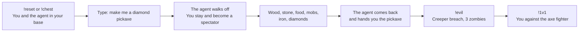

# Live demo walkthrough

This is the full show, in one world, on a real Minecraft server. You start in your own small base with the agent in front of you. You ask it for a diamond pickaxe in plain English. It walks off to do the job while you watch as a spectator. Then it comes back and hands you the pickaxe.



## Being built next

If you pick this up in another session, this is the target:

1. The gap in the base becomes an iron door with a button on each side. The agent presses the button to leave and to come home.
2. `!evil` stays on and keeps trying to kill you, wave after wave, until you end it. A gathering task, `!reset` or `!stop` turns it off, so it never runs during the gathering demo.
3. The evil god is more than a model wrapper. Code maps where mobs can really walk and tests each plan on that map. Claude Haiku chooses among the plans that passed, adapts during the raid, and remembers what worked against this player.
4. It can tell a base from a plain building or a dug-in hole. It looks for a respawn bed, chests and furnaces that have been used, blocks the player placed, time spent there and defenses. It rules out villages, temples and other structures the game generated.
5. It can reach a player who dug into the ground. It finds the cheapest route through the ground, chains creeper blasts, and comes through nearby caves.
6. Endermen can bridge a moat with real blocks from nearby, so zombies can cross and attack the base.
7. If more iron is right in front of the agent than you asked for, it takes that easy iron too, up to 12 per job. It never searches or detours for the extra.
8. A small display in the corner of the screen shows the agent's health, food, distance from you, time gone on the job, ready and raw food, building blocks, tools with durability, and other items.

## Start it

You need the agents server from [the setup guide](danger-sensing-agents-setup.md), running on this machine. Plain English needs an `ANTHROPIC_API_KEY` in your environment.

```sh
DEMO_PLAYER=<your Minecraft name> \
DEMO_FIGHTER_RUN=<folder of a trained fighter> \
node bridge/danger_sensing_agents/demo/run.js
```

Join the server. When the log says the demo is ready, type `!reset` in chat.

## The walkthrough

### 1. Start in your base

Type `!reset`. You stand in first person inside a small base. It has a bed, a chest, a furnace and cobblestone walls, with a gap in the south wall. The agent stands in front of you, facing you.

The agent starts with very little:

- A shield
- A stone axe
- 6 bread
- No armor

### 2. Ask for something in plain English

Type this in normal chat, with no command:

```text
make me a diamond pickaxe
```

Claude Haiku only reads your words and turns them into one request. A script plans every step from there. If your request is too vague, the agent asks what you mean. If it can't be done, the agent says so.

### 3. Watch it work

The agent answers and walks out of the base. You stay exactly where you are and become a spectator. Your body keeps standing at your spot, so you can see yourself in the base. Your camera is your own, so you can look around or fly after it.

To watch from the agent, type `!follow`. The camera stays on the agent, even after it respawns. Type `!unfollow` to fly free again.

Watch for these along the way:

- **Tools:** it chops wood with the axe. The wooden pickaxe only digs 3 cobblestone, then it makes a stone pickaxe. Dirt is dug by hand or with a shovel, so the pickaxe doesn't wear out.
- **Food:** it kills close animals on the way, before it gets hungry. It eats ready food like bread first and cooks raw meat in a furnace with coal or wood.
- **Torches:** it makes a small stock from spare coal and places only a few.
- **Fights:** zombies, skeletons, endermen and creepers switch it to the trained mob network.
- **Lava:** it won't break a block that is holding lava back, its paths stay clear of lava, and it swims to the nearest bank if it falls in.
- **Caves:** mobs sealed off in a cave under its floor can't reach it yet, so it keeps digging. They count again if it opens the floor.
- **Ores:** it only knows about ore it can actually see, with no seeing through walls.
- **Diamonds:** if it spots diamonds on a job that doesn't need them, it leaves them, tells you the coordinates once, asks if you want them, and keeps working.

### 4. Show a feature on cue

During a task, a zombie arrives at about 60 seconds and an animal at about 120 seconds. You can also send them yourself:

```text
!mob skeleton
!animal cow
```

### 5. Get your pickaxe

The agent walks back to the base. Once it arrives, you return to your body's spot in creative mode, even if you flew far away. The standing body disappears. The agent faces you and hands over the pickaxe. The demo checks your inventory and tells you if the item reached you.

### 6. Try the short version

Type `!chest`. This is the same start, but the base chest already holds 3 diamonds, 2 sticks and 4 oak planks. Ask for a diamond pickaxe again. The agent takes what it needs from the chest, crafts the pickaxe and hands it to you. It skips the long pathway.

Plain `!reset` always empties the chest, so the agent does the whole job.

### 7. Wake the evil god

```text
!evil
```

This uses the base you are already in. The gap in the wall closes. A creeper blows a hole in the wall, then 3 zombies come through it.

### 8. Fight it yourself

```text
!1v1
```

You and the trained axe fighter go to the arena in full diamond with an axe, sword, shield, crossbow and bow. A fight lasts up to 3 minutes, then you return to your base.

### 9. Run it again

`!reset` rebuilds the base for another go. `!stop` stops whatever is happening and brings you back to the base.

## Commands

| Type this | What happens |
|---|---|
| Plain words | A task for the agent, like `make me a diamond pickaxe` |
| `!reset` or `!start` | Your base with an empty chest and the agent's starting kit |
| `!chest` | The same, with the chest stocked for a diamond pickaxe |
| `!follow` | During a task, attaches your camera to the agent |
| `!unfollow` | Lets go of the agent so you can fly free |
| `!mob [zombie, skeleton, enderman, creeper]` | Sends a mob at the agent |
| `!animal [cow, pig, sheep, chicken]` | Puts an animal next to the agent |
| `!evil` | The creeper and zombies attack your base |
| `!1v1` | You fight the trained axe fighter, then return to the base |
| `!stop` | Stops everything and brings you back to the base |
| `!help` | Lists the commands |

Only the player named in `DEMO_PLAYER` can run these.

## Mobs in the demo

The demo keeps the four hostile mobs the network trained against: zombie, skeleton, enderman and creeper. Every other hostile mob is removed. Animals stay, so the agent can hunt them.

## When the agent dies

Every death adds a line to `runs/demo/deaths.jsonl` with the cause, place, health, food, job, held item, nearby mobs and nearby lava. To count deaths by cause:

```sh
node bridge/danger_sensing_agents/tools/deaths_summary.js runs/demo
```

## Settings

Every setting is listed at the top of `bridge/danger_sensing_agents/demo/settings.js`.
